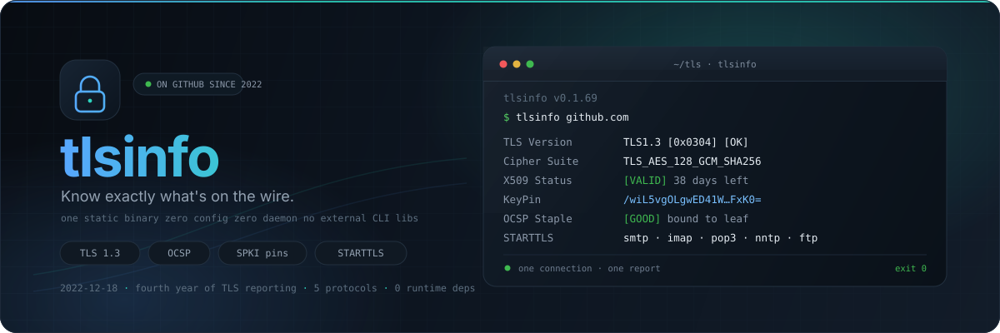
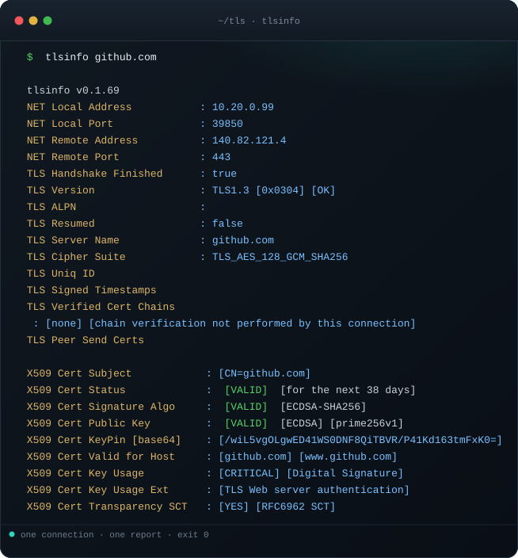
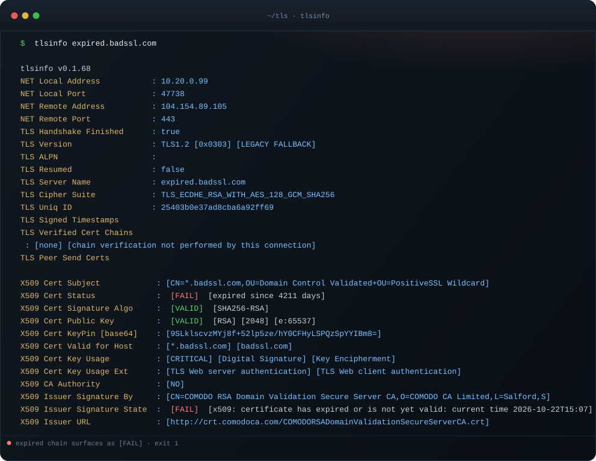

<div align="center">

<picture>
  <source media="(prefers-color-scheme: dark)" srcset="docs/hero-dark.svg">
  <source media="(prefers-color-scheme: light)" srcset="docs/hero-light.svg">
  
</picture>

# 🔐 tlsinfo

**TLS inspection without the archaeology.**

`openssl s_client` hands you a wall of PEM and a feeling. `tlsinfo` hands you a verdict:
one static binary, one connection, every TLS fact on the wire.

No config files. No daemon. No dependency tree.

**An established project.** On GitHub since December 2022, now in its fourth year of
releases, with a Dependabot-maintained dependency tree and a test suite that never touches
the network.

[](https://pkg.go.dev/paepcke.de/tlsinfo)
[](https://goreportcard.com/report/paepcke.de/tlsinfo)
[](go.mod)
[](https://github.com/paepckehh/tlsinfo/blob/master/LICENSE)
[](https://github.com/paepckehh/tlsinfo/releases/latest)
[](https://github.com/paepckehh/tlsinfo/commits)
[](https://search.nixos.org/packages?channel=unstable&show=tlsinfo&from=0&size=50&sort=relevance&type=packages&query=tlsinfo)

[](https://github.com/paepckehh/tlsinfo/actions/workflows/golang.yml)
[](https://github.com/paepckehh/tlsinfo/actions/workflows/codeql.yml)

[](https://github.com/paepckehh/tlsinfo/stargazers)
[](https://github.com/paepckehh/tlsinfo/network)
[](https://github.com/paepckehh/tlsinfo/issues)
[](https://github.com/paepckehh/tlsinfo/commits)

[paepcke.de/tlsinfo](https://paepcke.de/tlsinfo/)

</div>

---

> **TL;DR**
>
> ```shell
> go install paepcke.de/tlsinfo/cmd/tlsinfo@latest
> tlsinfo github.com
> ```
>
> Install. Run. Read the verdict. Nothing else to configure.

## Contents

- [Why tlsinfo](#why-tlsinfo)
- [See it in action](#see-it-in-action)
- [When TLS is broken](#when-tls-is-broken)
- [Install](#install)
- [Usage](#usage)
- [Library](#library)
- [How it works](#how-it-works)
- [Design promises](#design-promises)
- [Documentation](#documentation)
- [Contributing](#contributing)
- [License](#license)
- [Citation](#citation)

## Why tlsinfo

TLS is invisible until it isn't. Then you are three terminals deep in `openssl s_client`,
`openssl x509`, a calendar, a pinning spreadsheet and a browser devtools panel, trying to
answer one question: **is this connection what I think it is?**

`tlsinfo` answers it once, in one report, for the CLI and for your Go code, from the same
engine:

- 🧭 **Handshake truth, no interpretation** - TLS version, cipher suite, ALPN, resumption,
  SCT timestamps and the TLS unique ID, with instant `[OK]` / `[LEGACY FALLBACK]` /
  `[SECURITY ALERT]` verdicts.
- 📄 **Every certificate, parsed** - subject, validity window, signature algorithm, public
  key, SANs, chain layout and the SPKI key pin, without a single OpenSSL invocation.
- 🛡️ **OCSP that means something** - the stapled response is verified against the issuer
  *and bound to the presented leaf*. A valid staple for a different certificate is rejected.
  Stale staples get `[WARNING]`, revoked certificates get `[SECURITY ALERT]`.
- 📌 **Pins built for real use** - SPKI base64 pins for trust-on-first-use, even on
  untrusted or self-signed chains, with verification helpers ready for production.
- 🚀 **STARTTLS included** - SMTP, IMAP, POP3, NNTP and FTP upgrades, so the mail and news
  servers nobody remembers to check are one flag away.
- 🎨 **Output for humans and machines** - ANSI color, plain ASCII, HTML (injection-safe),
  or fully custom styles via `reportstyle`, plus raw PEM/OpenSSL detail on demand.
- 🧪 **Zero surprise dependencies** - pure Go, CGO off. Direct imports: the standard library
  plus [`certinfo`](https://pkg.go.dev/paepcke.de/certinfo),
  [`reportstyle`](https://pkg.go.dev/paepcke.de/reportstyle) and
  [`x/crypto`](https://pkg.go.dev/golang.org/x/crypto). Nothing heavier sneaks in.

### What ships where

| Capability | `tlsinfo` CLI | Go library |
|---|---|---|
| Full handshake, chain and verdict report | ✅ | ✅ |
| Base64 SPKI key pins | ✅ | ✅ |
| Pin verification (trust-on-first-use) | - | ✅ |
| Leaf-bound OCSP status | ✅ when stapled | ✅ `ReportOcsp` |
| STARTTLS: SMTP, IMAP, POP3, NNTP, FTP | ✅ | ✅ |
| Plain text, ANSI, HTML, custom styles | ✅ | ✅ |
| Reports for your own HTTPS clients | - | ✅ `ReportHttpRequest` |

## See it in action

Real output from a real connection, colors included:

<div align="center">
  
  <br>
  <sub><code>$ tlsinfo github.com</code> · captured live, colors untouched</sub>
</div>

Handshake, chain, key pin and certificate verdicts in a single pass. Pass several hosts, or
pipe a list and let it run:

```shell
tlsinfo github.com paepcke.de
echo github.com | tlsinfo
cat hosts.txt | tlsinfo
```

### One flag away from everything else

```shell
# just the base64 SPKI pin, nothing else
tlsinfo -pin github.com

# the mail server behind port 587
tlsinfo -starttls smtp smtp.gmail.com:587

# the news server nobody has checked since 2009
tlsinfo -starttls nntp news.eternal-september.org

# HTML for a dashboard, injection-safe
tlsinfo -html github.com | your-renderer

# raw PEM and OpenSSL-grade certificate detail
tlsinfo -verbose github.com
```

Hosts are normalized for you: the default port is appended, bare IPv6 literals are
bracketed, and empty input is rejected instead of quietly probing localhost.

## When TLS is broken

Expired chains, untrusted issuers, legacy fallbacks, stale staples and revoked leaves are
not buried in a wall of PEM. They are verdicts, in color, on the line that matters:

<div align="center">
  
  <br>
  <sub><code>$ tlsinfo expired.badssl.com</code> · a deliberately broken host, reported honestly</sub>
</div>

Exit codes are just as blunt:

| Code | Meaning |
|------|---------|
| `0`  | every host check succeeded |
| `1`  | a host check failed (unreachable, failed handshake, top-level `[error]`) |
| `2`  | usage error (bad flags, flags after hosts, no hosts at all) |

So `tlsinfo` slots straight into a deploy gate:

```shell
tlsinfo github.com || exit 1
```

## Install

```shell
# run it right now
go run paepcke.de/tlsinfo/cmd/tlsinfo@latest github.com

# install it
go install paepcke.de/tlsinfo/cmd/tlsinfo@latest
```

<details>
<summary><strong>Other install options</strong></summary>

Prebuilt binaries for Linux, macOS, Windows and the BSDs (amd64/arm64):
[github.com/paepckehh/tlsinfo/releases](https://github.com/paepckehh/tlsinfo/releases/latest).
`.deb` and `.rpm` packages are published with every release.

NixOS / Nix:

```shell
nix-shell -p tlsinfo
```

```nix
environment.systemPackages = [ pkgs.tlsinfo ];
```

Build from source:

```shell
git clone https://github.com/paepckehh/tlsinfo
cd tlsinfo
make build
./tlsinfo github.com
```

</details>

## Usage

### Command line flags

POSIX conventions, stdlib `flag`, `tlsinfo -h` prints usage with the version.
Every flag has an environment variable fallback for existing scripts
(empty value = off, see [no-color.org](https://no-color.org)):

| Flag           | Environment variable | Effect                                                          |
|----------------|----------------------|-----------------------------------------------------------------|
| `-starttls p`  | `STARTTLS`           | negotiate STARTTLS first: `smtp`, `imap`, `pop3`, `nntp`, `ftp` |
| `-pin`         | `PINONLY`            | print only the base64 SPKI key pin(s)                            |
| `-verbose`     | `VERBOSE`            | add raw / PEM / OpenSSL certificate details                      |
| `-html`        | `HTML`               | HTML output, escaped and ready for a page                        |
| `-no-color`    | `NO_COLOR`           | plain ASCII output, no ANSI colors                               |
| `-version`     | -                    | print the build-time version and exit                            |

Flags go **before** the hosts (`tlsinfo -pin github.com`, not `tlsinfo github.com -pin`).
Piped hosts win when the stream carries any; otherwise the command line is used.

### Version

Every run announces its build on stderr (`tlsinfo v0.1.69`), and `-version` prints just the
semver on stdout. Release binaries embed the git tag at build time; `go install ...@latest`
builds fall back to the module version recorded by the Go toolchain, so the startup line
stays a real semver instead of an empty placeholder.

### STARTTLS

Analyze mail and news servers that only speak TLS after an in-band upgrade:

```shell
tlsinfo -starttls smtp  smtp.gmail.com:587
tlsinfo -starttls imap  mail.example.com
tlsinfo -starttls pop3  mail.example.com
tlsinfo -starttls nntp  news.eternal-september.org
tlsinfo -starttls ftp   ftp.gnu.org
```

The protocol name is case- and whitespace-insensitive (`SMTP`, ` smtp ` both work), and the
default port is appended automatically.

### Key pins

```shell
# fetch the base64 SPKI pin of a host
tlsinfo -pin github.com

# works via STARTTLS too
tlsinfo -pin -starttls smtp smtp.gmail.com:587
```

Pin verification lives in the library (`PinVerifyHost`, `PinVerifyStartTLS`), so a pin
becomes a one-line check in your deploy pipeline.

## Library

The CLI is a thin wrapper around a pure Go engine. Import it and get the same report
without shelling out.

```go
package main

import (
	"os"

	"paepcke.de/tlsinfo"
)

func main() {
	os.Stdout.WriteString(tlsinfo.ReportHostText("github.com"))
}
```

Report the clients that hit your own HTTPS endpoint:

```go
// r is the *http.Request inside your handler
report := tlsinfo.ReportHttpRequestHTML(r)
```

Verify a trust-on-first-use pin:

```go
ok := tlsinfo.PinVerifyHost("/wiL5vgOLgwED41WS0DNF8QiTBVR/P41Kd163tmFxK0=", "github.com")
```

Check a mail server through STARTTLS:

```go
report := tlsinfo.ReportStartTLSText("smtp.gmail.com:587", tlsinfo.SMTP)
pin := tlsinfo.PinStartTLS("smtp.gmail.com:587", tlsinfo.SMTP, &tls.Config{})
```

### API

| Function | Input |
|----------|-------|
| `ReportHostText` / `ReportHostHTML` / `ReportHost` | hostname (+ `tls.Config`, `*reportstyle.Style`) |
| `ReportConnText` / `ReportConnHTML` / `ReportConn` | established `*tls.Conn` |
| `ReportTlsStateText` / `ReportTlsStateHTML` / `ReportTlsState` | `*tls.ConnectionState` |
| `ReportHttpRequestText` / `ReportHttpRequestHTML` / `ReportHttpRequest` | server-side `*http.Request` |
| `ReportOcsp` | `*tls.Conn` + issuer `*x509.Certificate` (bound to the leaf, stale responses flagged) |
| `ReportStartTLS` / `ReportStartTLSText` / `ReportStartTLSHTML` | hostname + `smtp`/`imap`/`pop3`/`nntp`/`ftp` |
| `PinHost`, `PinHostWithTLS` | hostname (+ `tls.Config`) |
| `PinStartTLS` | hostname + protocol (+ `tls.Config`) |
| `PinVerifyStartTLS` | key pin + hostname + protocol (+ `tls.Config`) |
| `PinVerifyHost`, `PinVerifyHostWithTLS` | key pin + hostname |
| `PinVerifyConn`, `PinVerifyState` | key pin + `*tls.Conn` / `*tls.ConnectionState` |

Output styles come from [`paepcke.de/reportstyle`](https://pkg.go.dev/paepcke.de/reportstyle):
plain text, ANSI console, HTML, or fully custom. Dynamic values (server name, ALPN, error
text, ...) pass through the style sanitizer, so HTML reports are escaped against injection
and wrapped in the style's `Start`/`End` markers.

Library guarantees worth knowing:

- your `*tls.Config` is **cloned**, never mutated, even though inspection forces
  `InsecureSkipVerify`;
- `nil` styles, connections and requests are tolerated (plain-text report, tagged error or
  `false`, never a panic);
- pin verification is false when the lookup failed, so an error message can never be
  mistaken for a matching pin;
- the library never writes to stdout. Output is always the returned string.

## How it works

1. The host is normalized (`:443` appended, bare IPv6 bracketed, empty hosts are rejected
   instead of probing localhost).
2. A TLS connection is opened, or a plaintext one upgraded through the protocol table.
3. `tls.ConnectionState` is walked and certificates are rendered by `certinfo`.
4. The result is assembled with the requested style and sanitized on the way out.

There is no daemon, no cache, no config and no background work. Each invocation is one
connection and one report.

## Design promises

- **Boring dependency tree.** Standard library plus three focused direct packages
  (`certinfo`, `reportstyle`, `x/crypto`), and only three transitive modules behind them
  (`certificate-transparency-go`, `go-logr/logr`, `k8s.io/klog/v2`). No framework, no CLI
  toolkit, no YAML loader.
- **Static binary.** `CGO_ENABLED=0` everywhere, including releases.
- **Offline tests.** The suite spins up loopback TLS and STARTTLS servers; `make test`
  never touches the network.
- **Readable failures.** Errors are embedded in the returned string as
  `[tlsinfo] [error] ...` / `[starttls] [error] ...`, so CLI exit codes and logs stay simple.
- **No surprises in HTML.** Every injected value is escaped through the style sanitizer.

## Documentation

- [pkg.go.dev/paepcke.de/tlsinfo](https://pkg.go.dev/paepcke.de/tlsinfo)
- Machine-readable repo overview for LLMs: [llms.txt](llms.txt)
- Agent/contributor notes: [AGENTS.md](AGENTS.md)
- Theme-aware README banners (hand-built SVG, `prefers-color-scheme`):
  [dark](docs/hero-dark.svg), [light](docs/hero-light.svg)
- Real terminal captures used above: [clean report](docs/demo-report.svg),
  [expired chain](docs/demo-alert.svg)
- Found a security issue? See [SECURITY.md](SECURITY.md)

## Contributing

Yes, please! PRs, issues and reproductions are welcome. Start with
[CONTRIBUTING.md](CONTRIBUTING.md), run `make test`, and keep the zero-dependency
philosophy intact.

## License

BSD 3-Clause. See [LICENSE](https://github.com/paepckehh/tlsinfo/blob/master/LICENSE).

## Citation

```bibtex
@misc{tlsinfo,
  author = {Michael Paepcke},
  title = {Tool to analyze and troubleshoot TLS connections (app/lib/api)},
  year = {2022},
  publisher = {GitHub},
  journal = {GitHub repository},
  howpublished = {\url{https://paepcke.de/tlsinfo}}
}
```
